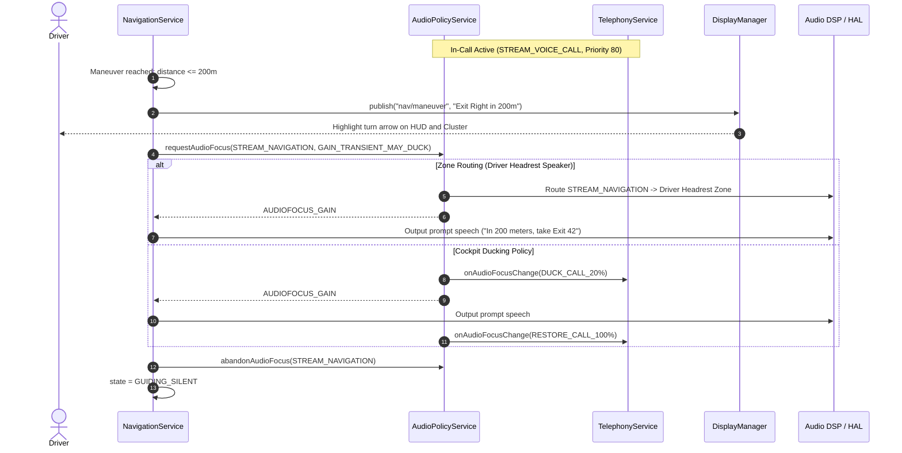
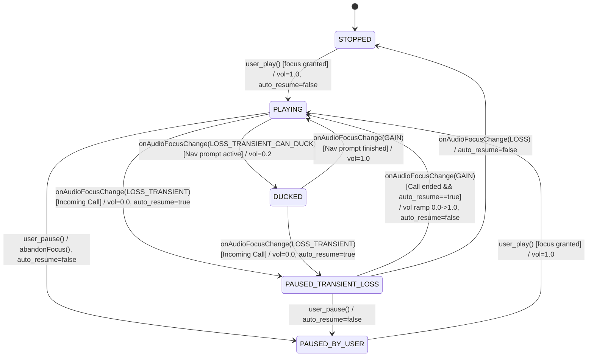
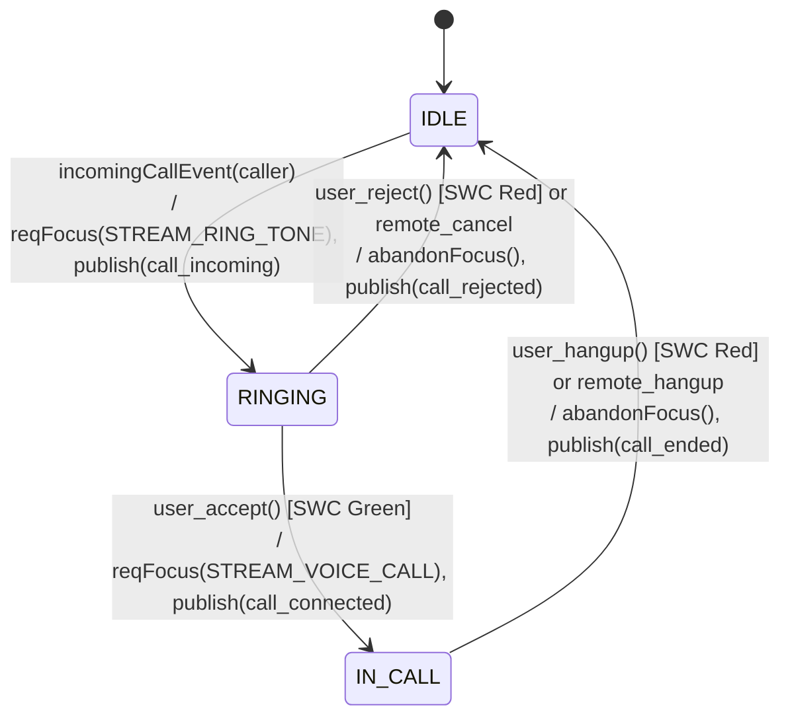

# Automotive In-Vehicle Infotainment (IVI) Service Interaction Model

## 1. Architectural Overview

Modern automotive digital cockpits rely on a **Service-Oriented Architecture (SOA)** (such as AUTOSAR Adaptive `ara::com`, Android Automotive OS (AAOS) Car Services, or COVESA IVI Architecture) to manage concurrent applications and prioritize safety-critical information.

This specification details the interaction between five core automotive software services:
1. **Audio Policy & Focus Manager (`AudioPolicyService`):** Central arbiter for all cockpit sound generators. Enforces stream priority, preemption, ducking, and stack-based focus restoration.
2. **Telephony Service (`TelephonyService`):** Manages cellular baseband/VoIP calls, ringtones, hands-free audio routing, and call lifecycle states.
3. **Media Playback Service (`MediaPlaybackService`):** Controls audio streaming (radio, music, podcasts) and implements stateful transient-loss memory for **automatic resumption**.
4. **Navigation Guidance Service (`NavigationService`):** Provides turn-by-turn routing, maneuvers, and high-priority transient speech alerts.
5. **Display & HMI Manager (`DisplayManager`):** Arbitrates visual real estate across the Center Information Display (CID), Digital Instrument Cluster (DIC), and Head-Up Display (HUD).

---

## 2. Audio Stream Classification & Priority Matrix

Audio streams in the vehicle are categorized by safety and driver assistance criticality. Lower-priority streams are either ducked or transiently paused when higher-priority streams request focus.

| Stream Type | Priority Level | Focus Request Type | Default Behavior against Lower Streams | Example Use Cases |
| :--- | :---: | :--- | :--- | :--- |
| `STREAM_EMERGENCY` | **100** | `GAIN_TRANSIENT_EXCLUSIVE` | Preempts all cabin audio (Mute/Pause) | ADAS collision warning, lane departure chime |
| `STREAM_VOICE_CALL` | **80** | `GAIN_TRANSIENT_EXCLUSIVE` | Pauses media; ducks/routes nav prompts | Active cellular phone call, eCall |
| `STREAM_RING_TONE` | **75** | `GAIN_TRANSIENT` | Pauses media; displays caller overlay | Incoming cellular call alert |
| `STREAM_VOICE_ASSISTANT`| **70** | `GAIN_TRANSIENT_EXCLUSIVE` | Pauses media; listens to user microphone | Cockpit voice command / Siri / Google Assistant |
| `STREAM_NAVIGATION` | **60** | `GAIN_TRANSIENT_MAY_DUCK` | Ducks media volume to 20% | "In 200 meters, take Exit 42" |
| `STREAM_MEDIA` | **40** | `AUDIOFOCUS_GAIN` | Preempted by any transient higher stream | Music playback, podcasts, terrestrial radio |
| `STREAM_NOTIFICATION`| **30** | `GAIN_TRANSIENT_MAY_DUCK` | Momentary duck or mix | SMS chime, calendar reminder |

---

## 3. Core Interaction Use Cases

### 3.1 Use Case 1: Incoming Call Interruption during Active Media and Navigation

When an incoming phone call arrives while the driver is listening to music and following navigation:
1. `TelephonyService` receives the call signaling from the modem and requests `AUDIOFOCUS_GAIN_TRANSIENT` for `STREAM_RING_TONE`.
2. `AudioPolicyService` detects that `STREAM_RING_TONE` (75) outranks `STREAM_MEDIA` (40).
3. `AudioPolicyService` dispatches `AUDIOFOCUS_LOSS_TRANSIENT` to `MediaPlaybackService`.
4. `MediaPlaybackService`:
   - Saves the current playback timestamp.
   - Arms the internal flag: `auto_resume_pending = true`.
   - Transitions from `PLAYING` to `PAUSED_TRANSIENT_LOSS` and mutes audio output.
5. `DisplayManager` handles visual arbitration:
   - Does **not** replace the navigation map entirely (which would compromise driving safety).
   - Displays an **Incoming Call Overlay / Heads-Up Dialog** on the CID.
   - Continues displaying turn-by-turn maneuver arrows and distance countdown on the Instrument Cluster and HUD.

#### UML Sequence Diagram: Incoming Call Interruption

```mermaid
sequenceDiagram
    autonumber
    actor Driver
    participant HMI as Steering Wheel / Touchscreen
    participant Tel as TelephonyService
    participant APM as AudioPolicyService
    participant Media as MediaPlaybackService
    participant Nav as NavigationService
    participant Disp as DisplayManager

    Note over Media, Nav: Initial State: Media is PLAYING, Nav route is active on CID
    
    Tel->>Tel: Network Event: Incoming Call ("Alice")
    Tel->>APM: requestAudioFocus(STREAM_RING_TONE, GAIN_TRANSIENT)
    
    rect rgb(30, 40, 60)
    Note over APM: Priority 75 (Ring) > 40 (Media).<br/>Notify Media of TRANSIENT LOSS.
    APM->>Media: onAudioFocusChange(AUDIOFOCUS_LOSS_TRANSIENT)
    Media->>Media: auto_resume_pending = true
    Media->>Media: state = PAUSED_TRANSIENT_LOSS, volume = 0.0
    end

    APM-->>Tel: AUDIOFOCUS_GAIN
    Tel->>Disp: publish("telephony/call_incoming", caller="Alice")
    Disp->>Disp: layout = NAV_WITH_CALL_OVERLAY
    Disp-->>Driver: Display Incoming Call Modal (Keep Nav Arrows on Cluster/HUD)

    Driver->>HMI: Press SWC Green Button (Accept Call)
    HMI->>Tel: acceptCall()
    Tel->>Tel: state = IN_CALL
    Tel->>APM: requestAudioFocus(STREAM_VOICE_CALL, GAIN_TRANSIENT_EXCLUSIVE)
    APM-->>Tel: AUDIOFOCUS_GAIN
    Tel->>Disp: publish("telephony/call_connected")
    Disp->>Disp: layout = SPLIT_NAV_AND_CALL
    Disp-->>Driver: Show Split View: Nav Map (Left) + Active Call UI (Right)
```

---

### 3.2 Use Case 2: Navigation Voice Prompt Handling during an Active Call

When a turn-by-turn navigation prompt triggers while a phone call is in progress:
- Route guidance alerts are safety-relevant, but sudden loud cabin interruptions during a business call distract the driver.
- **Automotive Arbitration Solutions:**
  1. **Dual Audio Zone / Headrest Routing (Preferred):** `AudioPolicyService` directs `STREAM_NAVIGATION` to the driver-seat headrest speakers or cluster sounder, while the call continues unhindered through the cabin speakers.
  2. **Call Ducking / Mixing:** If headrest isolation is unavailable, call volume is ducked slightly (to 80%), and the prompt is played concisely at standard volume.
  3. **Visual-Only Mode:** If the driver has toggled "Mute voice prompts during calls", the prompt audio is suppressed, but the HUD and cluster highlight the upcoming maneuver with high visual priority.

---

### 3.3 Use Case 3: Call Termination and Automatic Media Resume

When the call concludes:
1. `TelephonyService` transitions to `IDLE` and invokes `abandonAudioFocus()`.
2. `AudioPolicyService` pops `TelephonyService` from the top of the audio focus stack.
3. The next eligible service remaining in the stack is `MediaPlaybackService`.
4. `AudioPolicyService` sends `AUDIOFOCUS_GAIN` to `MediaPlaybackService`.
5. `MediaPlaybackService` evaluates its resume intent:
   - **Condition:** `previous_state == PAUSED_TRANSIENT_LOSS` **AND** `auto_resume_pending == true`.
   - **Action:** Transition to `PLAYING`, smoothly ramp volume from 0.0 to 1.0 (to avoid acoustic shock), and clear the `auto_resume_pending` flag.
   - **Negative Case Guard:** If the driver had explicitly paused playback before the call started (`PAUSED_BY_USER`), `auto_resume_pending` is `false`, and playback will **not** spuriously resume.
6. `DisplayManager` closes the call window and smoothly transitions the CID back to `FULL_NAVIGATION`.

#### UML Sequence Diagram: Call Termination & Automatic Media Resume

```mermaid
sequenceDiagram
    autonumber
    actor Driver
    participant HMI as Steering Wheel Button
    participant Tel as TelephonyService
    participant APM as AudioPolicyService
    participant Media as MediaPlaybackService
    participant Disp as DisplayManager
    participant AudioHAL as Audio DSP / Speakers

    Driver->>HMI: Press SWC Red Button (Hang Up)
    HMI->>Tel: endCall()
    Tel->>Tel: state = IDLE
    Tel->>APM: abandonAudioFocus(service.telephony)
    Tel->>Disp: publish("telephony/call_ended")

    rect rgb(30, 40, 60)
    Note over APM: Focus Stack Resolution:<br/>1. Pop Telephony<br/>2. Inspect next candidate: MediaPlaybackService<br/>3. Send AUDIOFOCUS_GAIN to Media
    APM->>Media: onAudioFocusChange(AUDIOFOCUS_GAIN)
    end

    alt auto_resume_pending == true
        Media->>Media: state = PLAYING
        Media->>Media: auto_resume_pending = false
        Media->>AudioHAL: Smooth volume fade-in (0.0 -> 1.0)
        Media->>AudioHAL: Resume audio playback at saved position
        AudioHAL-->>Driver: Music resumes automatically!
    else auto_resume_pending == false (User paused manually prior to call)
        Media->>Media: state remains PAUSED_BY_USER
        Note over Media: Do NOT play audio. Respect driver's manual pause!
    end

    Disp->>Disp: layout = FULL_NAVIGATION
    Disp-->>Driver: CID returns to Full Navigation view
```

---

## 4. State Machine Formal Specifications

### 4.1 Media Playback Service State Machine

### 4.2 Telephony Service State Machine

---

## 5. Simulink / Stateflow Implementation Architecture

The Simulink and Stateflow architecture models this discrete-event automotive control logic for code generation (`Embedded Coder`):
- **Inputs:** `u_MediaCmd` (uint8), `u_NavVoicePrompt` (boolean), `u_IncomingCall` (boolean), `u_CallAction` (uint8).
- **Outputs:** `y_MediaState` (uint8), `y_MediaVolume` (double), `y_CallState` (uint8), `y_DisplayMode` (uint8).
- **Automated Generator Script:** `simulink/create_ivi_service_model.m` provides complete programmatic creation of the Simulink block diagram and Stateflow chart.
- **Detailed Stateflow Logic:** Documented in [stateflow_logic.md](file:///d:/Automotive/mod6/simulink/stateflow_logic.md).

---

## 6. Verification and Validation

The service interaction model is verified using:
1. **Automated Unit & Integration Tests (`tests/test_interactions.py`):**
   - Incoming call interruption causing transient pause and arming `auto_resume_pending`.
   - Call termination triggering automatic playback resumption.
   - Call rejection triggering automatic playback resumption.
   - Intent preservation: user-paused media staying paused after a call.
   - Navigation voice prompt ducking (volume reduction to 20% and restoration).
2. **Interactive Simulation Console (`web/index.html`):**
   - Visual cockpit display (Cluster, HUD, CID).
   - Real-time DSP audio stream meters.
   - Interactive stimulus buttons and full automated scenario runner.
